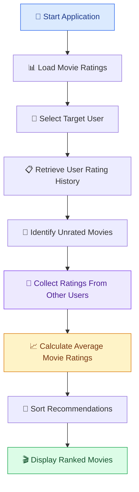
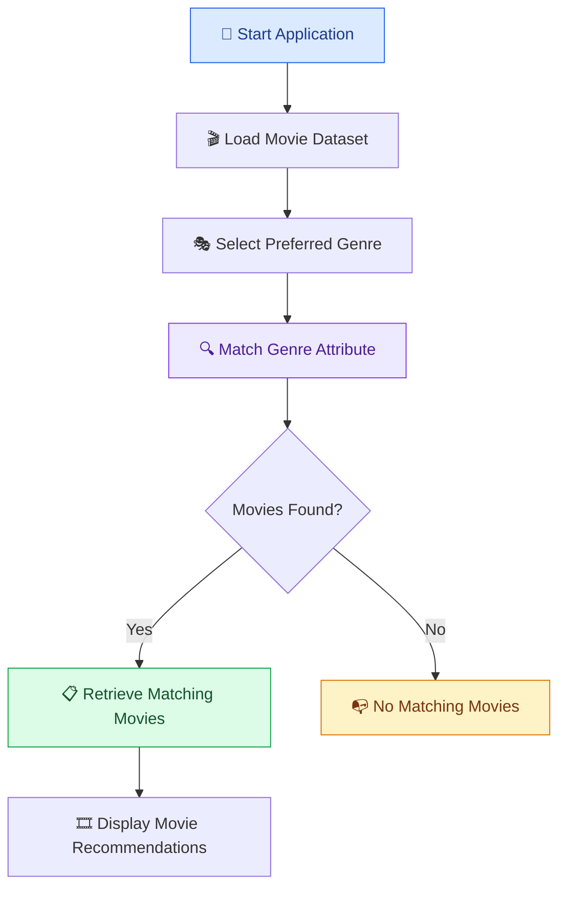
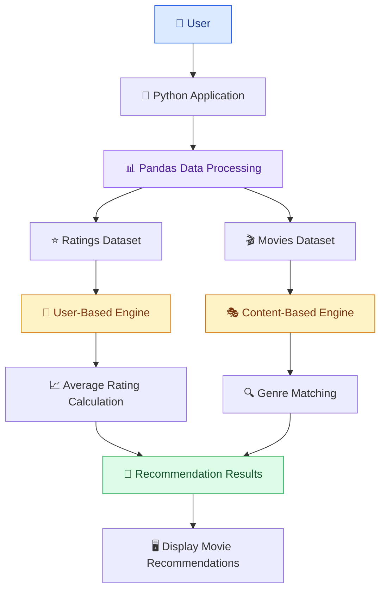

# 🎬 Movie Recommendation System
### Intelligent Movie Discovery Using User-Based & Content-Based Filtering

<p align="center">
  <b>Discover movies you'll love through ratings and genre-based recommendations.</b>
</p>

<p align="center">
  
  
  
  
  
</p>

---

## 🌟 Overview

**Movie Recommendation System** is a Python-based recommendation engine designed to demonstrate two fundamental approaches to personalized movie discovery: User-Based Recommendation and Content-Based Recommendation.

The system analyzes a small collection of movie ratings and movie metadata to generate recommendations based on user preferences and selected genres.

It provides two recommendation techniques:

- **User-Based Recommendation:** Identifies movies that a target user has not rated and ranks them using average ratings from other users.
- **Content-Based Recommendation:** Recommends movies belonging to a genre selected by the user.

Built using Python, NumPy, and Pandas, the project provides a lightweight introduction to recommendation systems and data-driven movie discovery.

### 🎯 Project Objectives

- Understand the fundamentals of recommendation systems.
- Implement user-based recommendation logic.
- Explore content-based filtering.
- Work with structured movie-rating datasets.
- Perform data filtering, grouping, and aggregation using Pandas.
- Generate ranked movie recommendations.
- Understand the foundations of collaborative and content-based filtering.

## ✨ Key Features

| Feature | Description |
|---|---|
| 👤 User-Based Recommendations | Suggests movies that other users rated highly. |
| 🎭 Genre-Based Filtering | Recommends movies based on the selected genre. |
| 🚫 Unseen Movie Filtering | Excludes movies already rated by the target user. |
| ⭐ Rating-Based Ranking | Sorts unseen movies by average ratings. |
| 📊 Data Analysis | Uses Pandas for filtering, grouping, and aggregation. |
| 🎬 Movie Metadata | Maintains movie titles, IDs, and genres. |
| ⚡ Lightweight Execution | Runs locally without external APIs or services. |
| 📦 Self-Contained Dataset | Uses an in-memory sample dataset. |
| 🐍 Python Implementation | Simple and easy-to-understand Python code. |

## 🖥️ Recommendation System Preview

The application demonstrates two different recommendation approaches.

<grid columns={2} gap={3}>
  <grid-item>
    <AsyncImage query="cinematic movie film reel popcorn dark movie theater aesthetic" aspectRatio="5:4" width="100%"/>
    **User-Based Filtering**

    <text color="secondary" size="xs">Discover highly rated movies you haven't watched or rated yet.</text>
  </grid-item>
  <grid-item>
    <AsyncImage query="movie genre film collage action thriller comedy cinematic posters" aspectRatio="5:4" width="100%"/>
    **Content-Based Filtering**

    <text color="secondary" size="xs">Explore movies matching your preferred genre.</text>
  </grid-item>
</grid>

## 🔄 How It Works — Recommendation Workflow

### 1. User-Based Recommendation Workflow

This approach identifies unseen movies and ranks them using ratings provided by other users.



### 2. Content-Based Recommendation Workflow

This approach filters the movie dataset according to a genre selected by the user.



## 🏗️ System Architecture

The recommendation system follows a simple data-processing architecture in which movie information and user ratings are processed to generate recommendations.



### Core Components

| Component | Responsibility |
|---|---|
| Movie Dataset | Stores movie IDs, titles, and genres. |
| Ratings Dataset | Stores user IDs, movie IDs, and ratings. |
| Data Processing | Uses Pandas to filter and organize records. |
| User-Based Engine | Identifies unseen movies and calculates average ratings. |
| Content-Based Engine | Filters movies according to the selected genre. |
| Recommendation Output | Displays the generated recommendations. |

## 🧠 Recommendation Algorithms

### 1. User-Based Recommendation

The user-based function recommends movies that the target user has not rated, using the average ratings provided by all other users.

**How it works:**

1. Retrieve all ratings belonging to the selected user.
2. Identify movies already rated by that user.
3. Exclude those movies from the recommendation candidates.
4. Collect ratings for the remaining movies from other users.
5. Calculate the average rating for each movie.
6. Sort the results in descending order.

**Average Rating Formula:**

\[
AverageRating(m)=\frac{\sum_{u \in U_m} Rating(u,m)}{|U_m|}
\]

Where:

- \(m\) = Candidate movie.
- \(U_m\) = Other users who rated movie \(m\).
- \(Rating(u,m)\) = Rating given by user \(u\) to movie \(m\).

**Important:** The current implementation averages ratings from all other users. It does not calculate user similarity or weight ratings according to similar preferences.

### 2. Content-Based Recommendation

The content-based function recommends movies belonging to a genre specified by the user.

**How it works:**

1. Receive a preferred genre.
2. Access the movie metadata dataset.
3. Compare the selected genre with the movie genre column.
4. Retrieve all matching movies.
5. Return the filtered movie records.

**Example:**

```python
genre_recs = recommend_movies_content_based("Action")
print(genre_recs)
```

This returns all movies whose genre exactly matches `Action`.

## 📊 Data Model

The project uses two in-memory Pandas DataFrames.

### 1. Ratings Dataset

The `ratings` DataFrame stores the relationship between users, movies, and their ratings.

| Column | Data Type | Description |
|---|---|---|
| `user_id` | Integer | Unique user identifier |
| `movie_id` | Integer | Unique movie identifier |
| `rating` | Integer | User rating between 1 and 5 |

**Example:**

| user_id | movie_id | rating |
|---|---|---|
| 1 | 1 | 5 |
| 1 | 2 | 3 |
| 2 | 1 | 4 |
| 2 | 3 | 2 |
| 3 | 4 | 4 |

### 2. Movies Dataset

The `movies` DataFrame contains movie metadata.

| Column | Data Type | Description |
|---|---|---|
| `movie_id` | Integer | Unique movie identifier |
| `title` | String | Movie title |
| `genre` | String | Movie category |

**Example:**

| movie_id | title | genre |
|---|---|---|
| 1 | Movie A | Action |
| 2 | Movie B | Comedy |
| 3 | Movie C | Action |
| 4 | Movie D | Thriller |

## 📁 Project Structure

```text
Movie-Recommendation-System/
│
├── recommender.py       # Main Python application
│                        # User-based recommendations
│                        # Content-based recommendations
│                        # Dataset processing
│
├── requirements.txt     # Python dependencies (optional)
│
└── README.md            # Project documentation
```

*The structure above is a recommended layout; adjust it to match your actual repository.*

## ⚙️ Requirements

Before running the application, make sure you have:

- Python 3.8 or later.
- pip package manager.
- Visual Studio Code or another Python editor.
- A terminal or command-line interface.

### Required Libraries

| Library | Purpose |
|---|---|
| Python | Core programming language |
| NumPy | Numerical computing |
| Pandas | Dataset manipulation and analysis |

## 🚀 Installation & Setup

Follow these steps to run the Movie Recommendation System locally.

### Step 1: Clone the Repository

```bash
git clone https://github.com/<your-username>/movie-recommendation-system.git
```

### Step 2: Navigate to the Project Directory

```bash
cd movie-recommendation-system
```

### Step 3: Create a Virtual Environment

```bash
python -m venv venv
```

Activate the environment:

**Windows:**

```bash
venv\Scripts\activate
```

**macOS / Linux:**

```bash
source venv/bin/activate
```

### Step 4: Install Dependencies

```bash
pip install numpy pandas
```

Alternatively, create a `requirements.txt` file:

```text
numpy
pandas
```

Then install:

```bash
pip install -r requirements.txt
```

### Step 5: Run the Application

```bash
python recommender.py
```

If your main Python file has a different name, replace `recommender.py` with that filename.

## 💻 Usage & Examples

The recommendation functions can be called directly from Python.

### 1. User-Based Recommendations

```python
# Generate recommendations for user 1
user_recs = recommend_movies_user_based(user_id=1)

# Display recommended movies
print("User-Based Recommendations:")
print(user_recs)
```

### 2. Content-Based Recommendations

```python
# Generate Action genre recommendations
genre_recs = recommend_movies_content_based(
    user_genre="Action"
)

# Display recommended movies
print("Content-Based Recommendations:")
print(genre_recs)
```

## 📋 Example Output

### User-Based Recommendations

```text
User-Based Recommendations:

movie_id
4    4.0
3    2.0

Name: rating, dtype: float64
```

### Content-Based Recommendations

```text
Content-Based Recommendations for Action genre:

   movie_id    title     genre
0         1  Movie A    Action
2         3  Movie C    Action
```

### Understanding the Output

For user 1:

- Movie D (`movie_id = 4`) receives an average rating of 4.0.
- Movie C (`movie_id = 3`) receives an average rating of 2.0.

Therefore, Movie D appears as the highest-ranked recommendation.

For content-based filtering, Movie A and Movie C are returned because both belong to the Action genre.

*These are illustrative outputs from the sample dataset.*

## 🔌 API / Function Reference

### `recommend_movies_user_based(user_id)`

Generates recommendations for a specified user.

| Parameter | Type | Description |
|---|---|---|
| `user_id` | Integer | Target user's unique identifier |

**Returns:** A Pandas Series indexed by `movie_id`, containing average ratings for unseen movies in descending order.

### `recommend_movies_content_based(user_genre)`

Generates recommendations based on a selected genre.

| Parameter | Type | Description |
|---|---|---|
| `user_genre` | String | Genre to search for |

**Returns:** A Pandas DataFrame containing all movie records whose genre exactly matches the supplied value.

## ⚖️ Comparison of Recommendation Techniques

| Parameter | User-Based | Content-Based |
|---|---|---|
| Input | User ID | Preferred genre |
| Data Used | User ratings | Movie metadata |
| Recommendation Basis | Average ratings from other users | Genre matching |
| Excludes Already Rated Movies | Yes | No |
| Ranking | Average rating, highest first | No ranking |
| Personalization | Limited | Based on selected genre |
| Main Advantage | Uses ratings from multiple users | Simple and transparent filtering |

## ⚠️ Design Notes & Current Limitations

Although the project demonstrates the fundamentals of recommendation systems, some limitations remain.

| Area | Current Limitation | Impact |
|---|---|---|
| User Similarity | No similarity calculation between users | Recommendations are not weighted by similar tastes |
| Genre Matching | Exact string matching only | No partial or multiple-genre matching |
| Dataset | Small, hardcoded sample dataset | Results are illustrative |
| Recommendation Output | User-based output contains movie IDs | Movie titles require an additional lookup |
| Cold Start | Limited handling of new users | No rating history means limited recommendations |
| Rating Analysis | Simple average-rating calculation | Popularity and rating distribution are not considered |
| Storage | In-memory datasets | Data is not persisted between executions |

## 🔭 Future Enhancements

The following improvements can make the project more advanced and suitable for a larger recommendation platform.

- [ ] **Collaborative Filtering:** Implement actual user similarity calculations.
- [ ] **Cosine Similarity:** Identify users with similar movie-rating preferences.
- [ ] **Pearson Correlation:** Measure similarity between user rating patterns.
- [ ] **User-Item Matrix:** Build a structured matrix for collaborative filtering.
- [ ] **Hybrid Recommendation Engine:** Combine user-based and content-based approaches.
- [ ] **Movie Title Integration:** Display movie names instead of only movie IDs.
- [ ] **Multi-Genre Support:** Support movies belonging to multiple genres.
- [ ] **Rating-Based Filtering:** Allow users to specify minimum rating thresholds.
- [ ] **External Movie Dataset:** Integrate the MovieLens dataset.
- [ ] **Persistent Database:** Store users, movies, and ratings using MySQL or SQLite.
- [ ] **Graphical Interface:** Build a user-friendly application using Streamlit or Flask.
- [ ] **Movie Poster Integration:** Display posters and additional movie details.
- [ ] **Personalized Profiles:** Allow users to rate movies and maintain watchlists.
- [ ] **Recommendation Evaluation:** Measure precision, recall, and ranking quality.

## 📈 Learning Outcomes

This project provides practical exposure to:

1. Recommendation system fundamentals.
2. Collaborative filtering concepts.
3. Content-based filtering.
4. Data manipulation using Pandas.
5. Numerical computing using NumPy.
6. Data aggregation and average calculations.
7. Filtering and sorting structured datasets.
8. Designing recommendation algorithms.
9. Understanding personalization and movie discovery.

## 🤝 Contributing

Contributions and improvements are welcome!

1. Fork the repository.
2. Create a feature branch:

```bash
git checkout -b feature/your-feature
```

3. Commit your changes:

```bash
git commit -m "Add your feature"
```

4. Push your branch:

```bash
git push origin feature/your-feature
```

5. Open a Pull Request describing your changes.

For major changes, open an issue first to discuss the proposed improvements.

## 📜 License

This project is intended for educational and learning purposes.

It is distributed under the MIT License. See the `LICENSE` file for details.

Ensure that the repository includes the corresponding MIT License file before distributing it under that license.

## 👨‍💻 Developer

<p align="center">
  <b>Lakshya Kansal</b>
  <br/>
  Python | Data Science | Machine Learning
  <br/><br/>
  <a href="https://github.com/lakshyakansal">
    GitHub
  </a>
</p>

---

<p align="center">
  ⭐ If you find this project useful, consider giving the repository a star!
  <br/><br/>
  <b>Movie Recommendation System — Turning Movie Ratings into Recommendations.</b>
  <br/>
  <i>Discover movies. Explore genres. Recommend smarter.</i>
</p>
